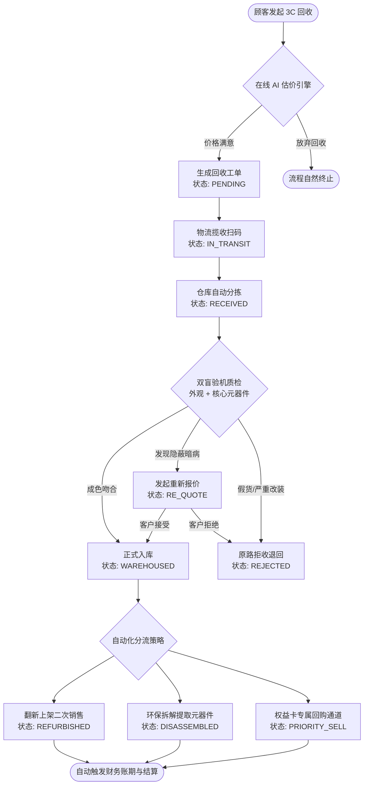
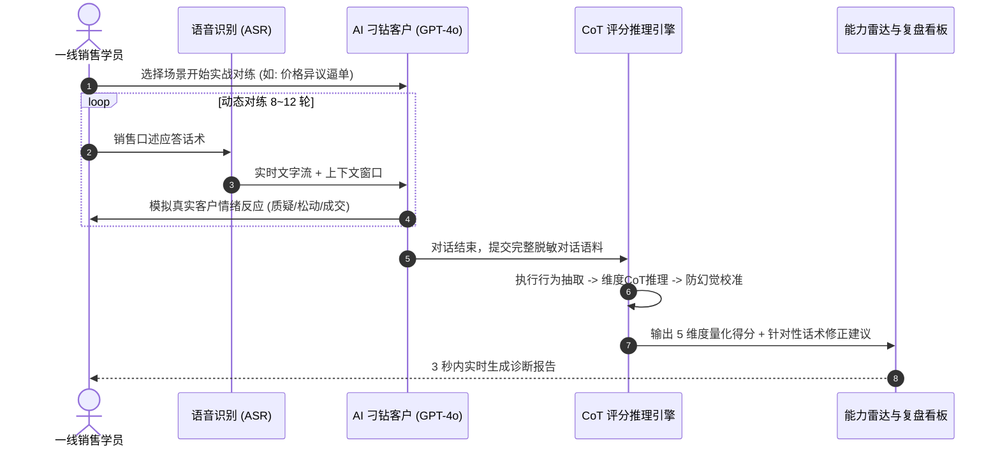
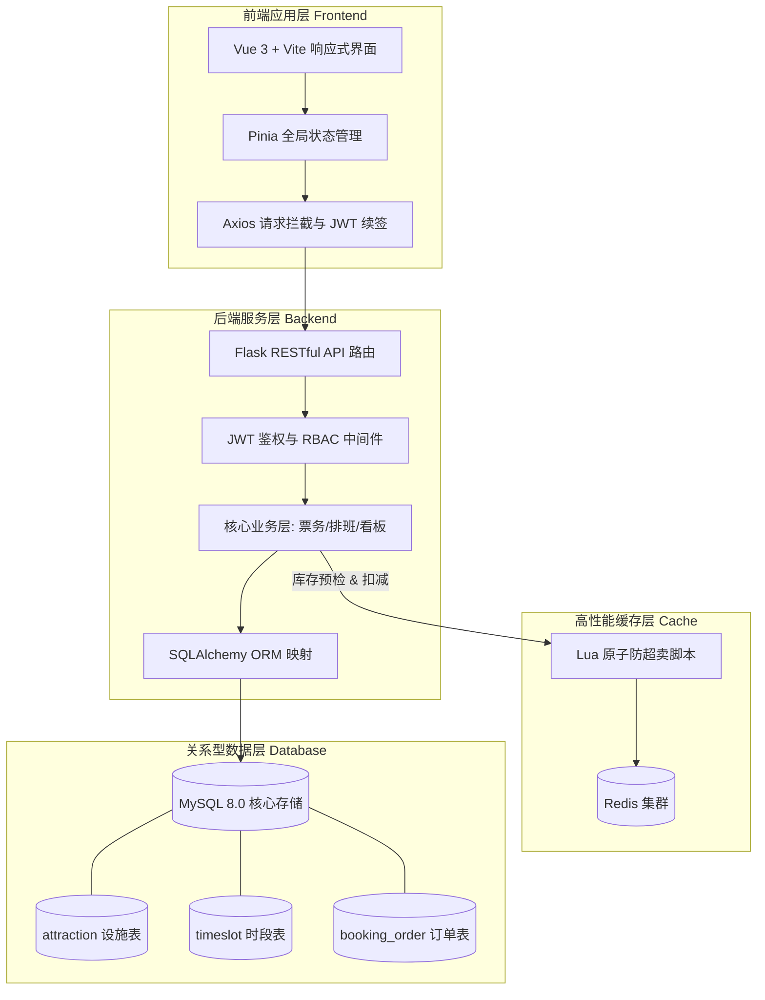

  

    🎬
    PROJECT STORYBOARDS · 真实战役复盘
  

  <h1 class="sb-banner-title">产品项目故事板</h1>
  

    摒弃冰冷单调的“负责了某某模块”式简历。在这里，每一场战役都是一次具体的工程冒险：遇到了什么令人头秃的业务巨坑、如何用产品逻辑与技术建模破局、最终拿下了怎样的量化战果。
  

<!-- ════════════════════════════════════════
     故事板 01：3C 零售 SaaS 平台
════════════════════════════════════════ -->

  
01

  

    

      SaaS平台架构
      多租户权限
      有限状态机 FSM
      库存中台
    

    <h2 class="story-title">3C 零售 SaaS 平台 · 售后回收系统从 0 到 1 架构设计</h2>
    

      “某头部 3C 零售集团，原来几十家直营店和加盟店的售后全靠打勾画叉的内部 OA 和 Excel，状态扯皮、设备丢件是家常便饭。”
    

  

<h3 class="story-act-heading">💣 Act 1：踩坑现场 · 遭遇什么业务巨坑？</h3>

::: danger ⚠️ 真实痛点全景
* **「OA 孤岛困境」**：售后与质检数据散落在 ERP、WMS、CRM、财务、工单 5 套内部系统中，回收设备处于哪个质检环节只能电话反复催问。
* **盘点误差惊人**：每月全国库位盘点误差率高达 **12%**，翻新零件流向不明。
* **履约时效崩溃**：客诉处理平均需要 **3.2 天**，客户在店面拍桌子退卡成为日常。
:::

<h3 class="story-act-heading">🧠 Act 2：破局推演 · 产品抽象与架构拆解</h3>

::: info 📐 架构破局思路
1. **回收全链路有限状态机（FSM）**：严禁任意跳步修改订单状态，所有跳转严格绑定触发事件（如物理扫码验机、估价签名确认）。
2. **多租户权限中台**：直营店 vs 区域加盟商在数据层严格物理隔离，操作权限精细到“某门店具体设备的二次报价权”。
3. **至臻权益卡数字化**：设计防薅羊毛风控评分模型（`risk_score > 0.7` 自动冻结），打通跨门店通兑核销与账期结算。
:::

<h3 class="story-act-heading">🗺️ Act 3：业务状态机流程图</h3>

<h3 class="story-act-heading">🏆 Act 4：战果交付 · 用数据说话</h3>

  

    
12%→1.3%

    
月度盘点误差率

  

  

    
3.2天→6h

    
客诉平均响应时长

  

  

    
230+

    
接入门店与网点

  

  

    
40%↓

    
售后人工复核工时

  

::: tip 💡 核心设计复盘
该项目沉淀出了首个完整的**设备全生命周期流转图谱**，原本令人头疼的质检与折旧数据，反向为集团后续搭建“AI 动态估价模型”提供了最关键的干净训练集。
:::

<!-- ════════════════════════════════════════
     故事板 02：AI 销售对练与打分助手
════════════════════════════════════════ -->

  
02

  

    

      LLM Agent 落地
      Prompt Engineering
      CoT 结构化打分
      降本增效
    

    <h2 class="story-title">企业级 AI 销售培训与智能打分助手</h2>
    

      “3,000+ 名一线销售每年靠资深讲师人肉陪练，打分标准随心情波动，新人等一轮模拟面试得排队三周……”
    

  

<h3 class="story-act-heading">💣 Act 1：踩坑现场 · 遭遇什么业务巨坑？</h3>

::: danger ⚠️ 传统企业培训的三座大山
* **培训成本高得离谱**：每场销售面试实操需 2 名资深导师全程陪练，单人次培训成本高达 **¥800/次**。
* **考核主观性如同开盲盒**：讲师喜好不一，同一段对话录音换两个讲师打分，分差竟然高达 **25 分**。
* **反馈周期极长**：销售练完之后，书面改进建议要 **5 个工作日**才能发到手上，早已忘记当时的话术语境。
:::

<h3 class="story-act-heading">🧠 Act 2：破局推演 · PREP 人格体系与 CoT 评分引擎</h3>

::: info 📐 提示词工程与系统链路设计
1. **PREP 客户人格模拟**：
   - **P**ersona（精准人格设定，如 35 岁、私营业主、注重性价比）
   - **R**esistance（预设核心异议点，模拟真实抗拒态度）
   - **E**motion（动态情绪曲线：销售话术扎实则松动，套话敷衍则升级愤怒）
   - **P**ath（自然成交判定链路）
2. **CoT（Chain-of-Thought）结构化五维评分**：
   - 强制要求大模型在给出分数前，先输出具体的亮点行为举证与扣分理由；
   - 引入 50 条专家打标的“黄金基准样本”，有效消除模型评分幻觉。
:::

<h3 class="story-act-heading">🗺️ Act 3：人机对抗与评分时序图</h3>

<h3 class="story-act-heading">🏆 Act 4：战果交付 · 用数据说话</h3>

  

    
¥800→¥35

    
单次培训综合成本

  

  

    
40%→94%

    
年度学员覆盖率

  

  

    
5天→3秒

    
诊断报告反馈时效

  

  

    
r = 0.923

    
AI与讲师打分相关度

  

::: tip 🔬 实验证明
上线前进行了严格的 120 场双盲评测：AI 打分与专家团队打分的 Pearson 相关系数达到 **r=0.923**，甚至超越了讲师之间的互评一致性（r=0.871）！
:::

<!-- ════════════════════════════════════════
     故事板 03：全栈独立游乐园管理系统
════════════════════════════════════════ -->

  
03

  

    

      独立全栈落地
      Flask / Vue 3
      Redis Lua 防超卖
      工程认知沉淀
    

    <h2 class="story-title">Web 端游乐园运营管理系统 · 全栈独立设计与实现</h2>
    

      “我不认同‘产品经理只负责画线框图’。为了能在正确的抽象层上与工程师对等对话，我亲手写了从数据库索引到前端状态管理的全部代码。”
    

  

<h3 class="story-act-heading">💣 Act 1：踩坑现场 · 遭遇什么业务巨坑？</h3>

::: danger ⚠️ 高频履约业务的典型陷阱
* **高峰期票务超卖**：传统在 MySQL 事务中 `SELECT ... FOR UPDATE` 很容易产生行级锁等待甚至死锁，并发一旦超过 200 QPS 数据库直接卡死。
* **排班冲突逻辑模糊**：员工、设施、班次关联关系繁琐，原型如果没想清楚边界条件，开发阶段极易产生“同一员工同一时间被双派工”的脏数据。
:::

<h3 class="story-act-heading">🧠 Act 2：破局推演 · 架构设计与工程选型</h3>

::: info 📐 产品向技术视角的转变
1. **Redis + Lua 脚本原子性扣减**：把并发库存校验前置到缓存层，查库存与减库存合并为单步原子操作，抗住 2000+ QPS 峰值。
2. **数据库唯一键约束防冲突**：给 `timeslot` 表与员工排班表增加复合唯一索引 `UNIQUE KEY uk_attraction_slot (attraction_id, slot_date, slot_start)`，从存储层彻底杜绝业务逻辑漏网之鱼。
:::

<h3 class="story-act-heading">🗺️ Act 3：全栈系统架构图</h3>

<h3 class="story-act-heading">🏆 Act 4：战果交付 · PM 视角的三个认知跃迁</h3>

::: warning 📌 这次工程实战带给 PM 工作的真正底气
1. **接口设计即业务语义**：退款和取消绝不能偷懒合并为一个接口，状态机区分清楚，研发沟通成本砍半。
2. **索引与吞吐量的权衡**：明白了“索引不是免费的”，提看板需求时不再盲目要求所有字段任意组合实时多维筛选。
3. **前端状态是产品复杂度的镜子**：Pinia store 越难维护，说明交互状态设计越冗余。在 PRD 原型阶段就把数据流向梳理顺畅，而不是让前端去猜。
:::

